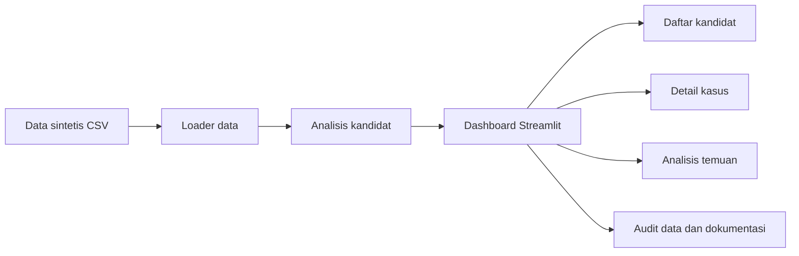

# JagaPasien AI

## Tagline
AI untuk Menjaga Kesinambungan Pelayanan Pasien JKN

## Ringkasan solusi
JagaPasien AI adalah prototipe dashboard berbasis Python dan Streamlit yang membantu memprioritaskan pasangan kunjungan pasien JKN yang memerlukan telaah lebih lanjut. Fokus utama prototipe adalah pada pola kunjungan tidak biasa, potensi duplikasi dokumentasi, dan kesinambungan episode pelayanan. Sistem tidak digunakan untuk menetapkan fraud secara otomatis dan tidak menggantikan penilaian klinis.

## Latar belakang masalah
Pelayanan JKN menghadapi kebutuhan untuk menjaga kesinambungan episode pelayanan, memotret kunjungan berulang, dan meminimalkan risiko duplikasi dokumentasi yang memerlukan pemeriksaan lebih lanjut. Dengan data sintetis, prototipe ini berfungsi sebagai alat bantu telaah awal yang dapat diulang, dibaca, dan dikaji ulang dengan transparansi.

## Tujuan
- Memprioritaskan pasangan kunjungan yang layak ditelaah manual.
- Menyajikan pola anomali secara visual dengan konteks terbatas.
- Memberikan basis penjelasan yang eksplisit dan tidak berlebihan.
- Menyediakan prototipe yang dapat dijalankan secara lokal di laptop Windows.

## Fitur aplikasi
- Dashboard overview dengan KPI dan grafik.
- Tabel kandidat review interaktif dengan filter dan download CSV.
- Detail kasus per case ID.
- Timeline kunjungan pasien berdasarkan data kunjungan sintetis.
- Analisis temuan indikatif berdasarkan variabel yang tersedia.
- Penjelasan metodologi AI yang transparan.

## Teknologi
- Python 3.10+
- Streamlit
- Pandas
- Plotly
- scikit-learn
- Joblib
- Pytest

## Metodologi AI
Prototipe ini menggunakan Isolation Forest untuk mengidentifikasi observasi yang relatif tidak biasa dibanding pola umum di dataset sintetis. Metode ini bersifat unsupervised dan tidak memerlukan label fraud aktual. Hasilnya berupa prioritas telaah, bukan probabilitas fraud. Karena tidak ada label validasi klinis, akurasi spesifik terhadap data nyata belum tersedia.

## Diagram alur


## Struktur folder
```text
jagapasien-ai/
├── app.py
├── requirements.txt
├── README.md
├── .gitignore
├── .streamlit/
│   └── config.toml
├── src/
│   └── jagapasien/
│       ├── __init__.py
│       ├── data_loader.py
│       ├── analysis.py
│       └── visualization.py
├── scripts/
│   └── audit_dataset.py
├── docs/
│   ├── AUDIT_DATA.md
│   ├── METODOLOGI.md
│   ├── BATASAN.md
│   └── SUBMISSION.md
├── tests/
│   ├── test_data_loader.py
│   └── test_analysis.py
├── data/
│   ├── raw/
│   ├── processed/
│   └── models/
└── hasil_jagapasien_ai.csv
```

## Cara instalasi di Windows
Buka PowerShell di folder proyek dan jalankan:

```powershell
py -m venv .venv
.\.venv\Scripts\python.exe -m pip install --upgrade pip
.\.venv\Scripts\python.exe -m pip install -r requirements.txt
```

## Cara menjalankan aplikasi lokal
```powershell
.\.venv\Scripts\python.exe -m streamlit run app.py
```

Aplikasi akan terbuka di browser secara lokal. Jika port default sudah terpakai, Streamlit akan memilih port baru dan menampilkan URL yang relevan di terminal.

## Cara menggunakan dashboard
1. Buka halaman Overview untuk melihat ringkasan KPI dan grafik.
2. Buka halaman Daftar Kandidat untuk menyaring prioritas, faskes, ID pasien, dan ID kasus.
3. Pilih case ID untuk melihat detail dan timeline kunjungan pasien.
4. Gunakan halaman Analisis Temuan untuk melihat kelompok temuan indikatif.
5. Baca halaman Metodologi AI agar pemahaman tentang scoping dan batasan jelas.

## Hasil eksperimen yang terverifikasi
- Data sintetis yang tersedia berhasil dibaca pada workspace lokal.
- Jumlah kandidat hasil analisis: 6.114 baris pada file hasil_jagapasien_ai.csv.
- Pasangan kunjungan yang dianalisis: 13.149 baris pada pasangan_kunjungan.csv.
- Pasien unik pada data pasien sintetis: 10.000.
- Kunjungan unik pada data kunjungan sintetis: 35.009.
- Prioritas review dari file hasil yang dipilih: Tinggi 295, Sedang 5.210, Rendah 609.
- Selisih 62 terhadap metadata dan ringkasan JSON tidak dijelaskan secara definitif berdasarkan bukti yang tersedia; dokumentasi audit menyebutkan ketidaksesuaian sebagai perbedaan antar tahap yang belum direkonsiliasi.

## Data sintetis
Semua data yang digunakan pada prototipe bersifat sintetis dan bukan data rekam medis nyata. Dataset ini dirancang untuk simulasi dan telaah pola, bukan untuk proses adjudikasi klaim atau keputusan klinis.

## Batasan model
- Tidak ada label fraud aktual untuk akurasi klinis.
- Tidak ada validasi pada data pelayanan JKN nyata.
- Skor prioritas dan persentil anomali bukan probabilitas fraud.
- Sistem tidak digunakan untuk menentukan keputusan klaim atau kepatuhan klinis.

## Rencana pengembangan
- Validasi model terhadap data nyata dengan konteks klinis.
- Penguatan aturan pengecualian klinis dan penjelasan kasus.
- Perbaikan tampilan dashboard untuk kebutuhan stakeholder internal.
- Pemetaan output ke protokol audit manual yang lebih kuat.

## Placeholder identitas
- Nama pemilik: [NAMA PEMILIK]
- Nama tim: [NAMA TIM]
- URL GitHub: [URL GITHUB]

## Disclaimer
JagaPasien AI merupakan prototipe berbasis data sintetis untuk mendukung telaah pola kunjungan. Sistem tidak digunakan untuk menetapkan fraud, mengambil keputusan klaim, atau menggantikan penilaian klinis.
